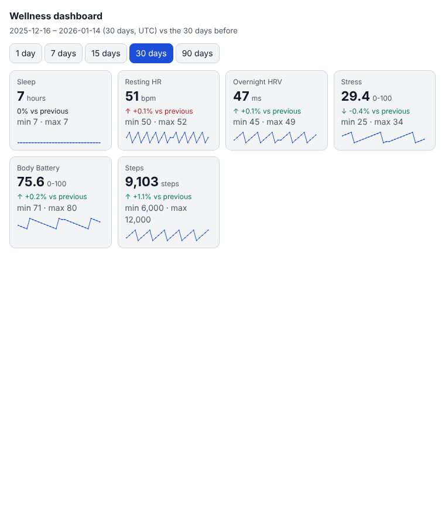
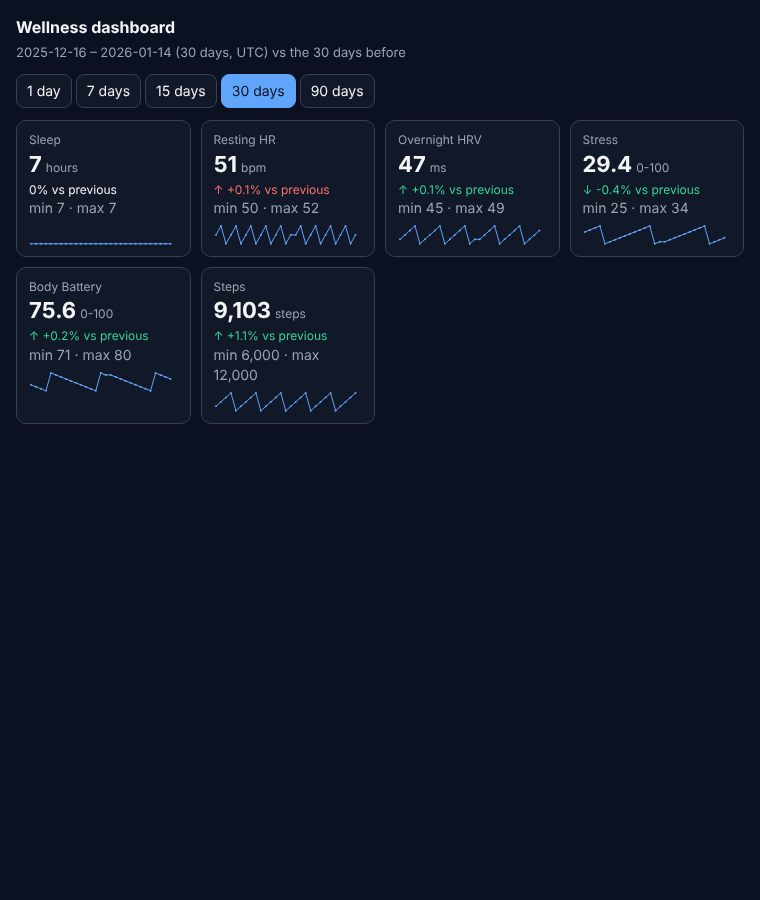
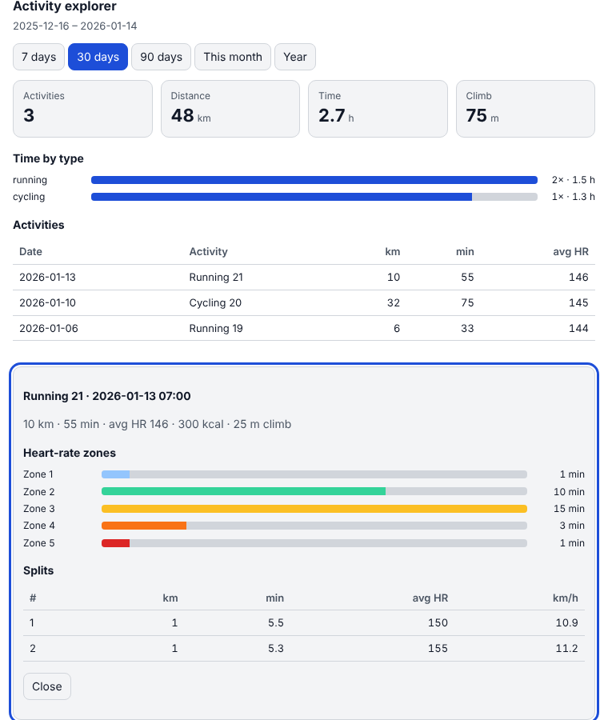
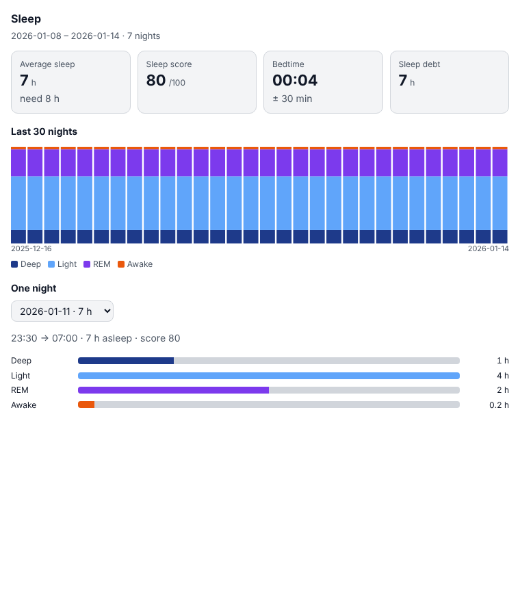
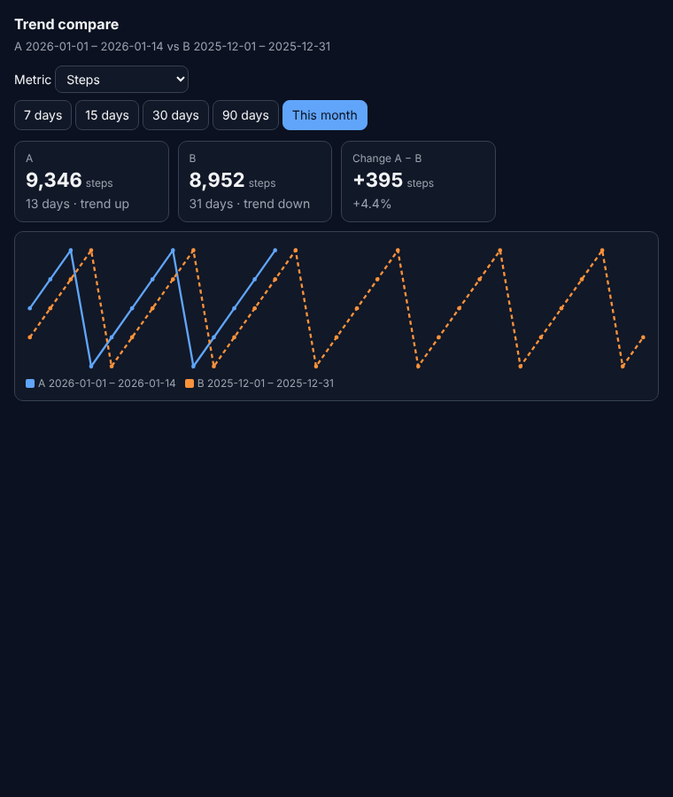
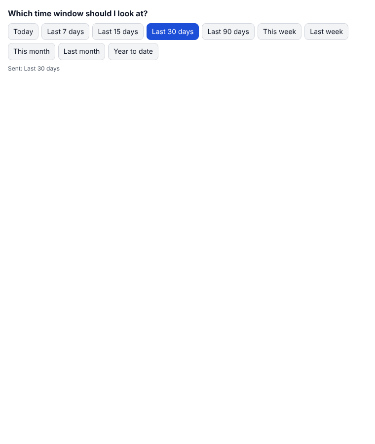

# garmin-mcp

[](https://github.com/SarathChandraBellam/garmin-mcp/actions/workflows/ci.yml)
[](LICENSE)
[](https://modelcontextprotocol.io)
[](https://github.com/astral-sh/uv)
[](https://www.python.org)

A **stateless, bring-your-own-key** [Model Context Protocol](https://modelcontextprotocol.io)
server that lets an MCP client (Cursor, Claude, and others) read **your** Garmin
Connect data through Garmin's official **Personal API**.

The server never stores your key or your fitness data. Each request carries the
key (like a GitHub personal access token), the server exchanges it for a
short-lived Garmin token (held in memory only), calls Garmin, returns the result,
and forgets it.

## Why this exists

Garmin now offers a self-serve [Personal API](https://developer.garmin.com/gc-developer-program/personal/personal-api)
so individuals can access their own health and activity data with a key created
in Garmin Connect. This project wraps that API as an MCP server so you can ask
an assistant about sleep, training, or daily stats without standing up a
database or handing a password to a third party.

## Features

- Official Garmin Connect Personal API (no password login, no unofficial scraping)
- Multi-tenant: every client sends **its own** key; the deployment holds none
- MCP endpoint at **`/mcp`**; product page with an API-key guide at **`/`**
- Stateless Streamable HTTP (`stateless_http=True`, JSON responses; MCP 2025-06-18 and 2026-07-28 clients)
- Also runs locally over **stdio**
- Read-only tools for activities, daily summaries, sleep, heart rate, HRV, body
  composition, SpO2, and daily stat series
- **Analytics tools** that answer with statistics instead of raw payloads: wellness
  overview, trends, period comparison, activity totals, sleep analysis, a recovery
  estimate and goal streaks, with typed output schemas and a short text summary
- **Time windows** (`period=last_7d`, `last_30d`, `last_90d`, `this_month`, `ytd`, …)
  in the caller's own timezone, with long ranges fetched in parallel chunks
- **Elicitation** that works on stateless HTTP: the server asks the user only when it
  helps, and every tool still works when the client can't ask
- **MCP Apps**: an interactive dashboard, activity explorer, sleep view, trend compare
  and period picker in hosts that support them
- HTTPS required in production; missing or invalid keys return **401**
- Coordinates and owner profile fields are stripped from activity output

## Security model

| The server stores | The client sends |
|---|---|
| Nothing durable. A Garmin bearer token may sit in memory on a warm instance, keyed by SHA-256 of the API key, and dies with the process. | Your Personal API key on every HTTP request (`X-Garmin-Api-Key` or `Authorization: Bearer`), or `GARMIN_API_KEY` for local stdio. |

A missing key returns `401 missing_garmin_api_key`, and a key Garmin rejects
returns `401 invalid_garmin_api_key`. If Garmin is unreachable the server
returns `502` (or `429` when Garmin rate-limits). Headers are never logged.
Create, rotate, and revoke keys in Garmin Connect.

**Limitation:** there is no OAuth sign-in, so clients that can't send a custom
header (Claude.ai on the web and mobile, for example) can't connect yet. Adding
OAuth later is sketched in [PLAN-garmin-official-oauth.md](PLAN-garmin-official-oauth.md).

## Disclaimer

**This project is not affiliated with, endorsed by, or sponsored by Garmin Ltd.
or its subsidiaries.** "Garmin" and "Garmin Connect" are trademarks of Garmin.
The software talks to Garmin's [Personal API](https://developer.garmin.com/gc-developer-program/personal/personal-api)
on your behalf. By using it you agree to [Garmin's terms](https://www.garmin.com/legal/)
and the Personal API terms shown when you create a key. Use it only with a key
you are authorised to use (typically your own).

## Get a Garmin Personal API key

1. Sign in at [Personal API Key settings](https://connect.garmin.com/app/settings/personalApiToken) → **Create Key**.
2. Choose an expiry (30 / 90 / 180 / 365 days) and copy the key (it is shown once). Treat it like a password.
3. Revoke it on the same page at any time; tokens derived from it stop working.

## Quick start

### Hosted HTTP

Endpoint: `https://<DEPLOY_URL>/mcp`. Open `https://<DEPLOY_URL>/` for the
API-key guide and copy-ready snippets.

```http
X-Garmin-Api-Key: <your key>
```

(`Authorization: Bearer <your key>` is also accepted.) Optionally add
`X-Timezone: <IANA zone>` (for example `Asia/Kolkata`) so "today" matches your day.

**Cursor** (`~/.cursor/mcp.json`):

```json
{
  "mcpServers": {
    "garmin": {
      "url": "https://<DEPLOY_URL>/mcp",
      "headers": { "X-Garmin-Api-Key": "${env:GARMIN_API_KEY}" }
    }
  }
}
```

**Claude Code:**

```bash
claude mcp add --transport http garmin https://<DEPLOY_URL>/mcp \
  --header "X-Garmin-Api-Key: $GARMIN_API_KEY"
```

**Claude Desktop** (`claude_desktop_config.json`, via `mcp-remote`):

```json
{
  "mcpServers": {
    "garmin": {
      "command": "npx",
      "args": [
        "-y", "mcp-remote", "https://<DEPLOY_URL>/mcp",
        "--header", "X-Garmin-Api-Key:${GARMIN_API_KEY}"
      ],
      "env": { "GARMIN_API_KEY": "<your key>" }
    }
  }
}
```

### Local stdio (no hosted server)

From a checkout:

```bash
uv sync
GARMIN_API_KEY=<your key> uv run garmin-mcp
```

**Cursor / Claude Desktop:**

```json
{
  "mcpServers": {
    "garmin": {
      "command": "uvx",
      "args": ["--from", "git+https://github.com/SarathChandraBellam/garmin-mcp", "garmin-mcp"],
      "env": { "GARMIN_API_KEY": "<your key>" }
    }
  }
}
```

`uvx --from git+…` needs git access to the repository (public, or an SSH/HTTPS
credential if it is still private). Otherwise install from a local clone and
use `"command": "uv", "args": ["--directory", "/path/to/garmin-mcp", "run", "garmin-mcp"]`.

## Tools (all read-only)

**Analytics** (typed output schema plus a one-line text summary; `detail=summary` by
default, `daily` adds one value per day, `raw` adds the PII-free Garmin records):

| Tool | Returns |
|---|---|
| `get_wellness_overview` | Average/min/max and trend for sleep, resting HR, HRV, stress, Body Battery and steps, each with the change vs the previous window of the same length (default `last_7d`) |
| `get_trends` | For 1-6 metrics: average, total, spread, slope, best/worst day, missing days and the change vs the previous period; `granularity=week` for weekly averages (default `last_30d`) |
| `compare_periods` | One metric across two windows side by side, with the change. Asks for the second window if it is missing |
| `get_activity_summary` | Count, distance, time, elevation, calories and minutes in each HR zone, grouped by type or week, plus the longest and fastest activity |
| `get_sleep_analysis` | Average stages and score, bedtime / wake-time consistency, and sleep debt against sleep need |
| `get_recovery_status` | HRV, sleep and Body Battery combined into one 0-100 readiness estimate with an explanation (our own heuristic, not Garmin's Training Readiness) |
| `get_goal_streaks` | Days the step goal was met (or weeks the intensity-minutes goal was met) and the current / longest streak |
| `pick_period` | Shows the period picker app; text-only clients get the list of options |

Metrics for `get_trends` and `compare_periods`: `steps`, `resting_hr`, `hrv`, `stress`,
`body_battery`, `sleep_hours`, `sleep_score`, `intensity_minutes`, `calories`,
`weight_kg`, `vo2max`.

**Data:**

| Tool | Returns |
|---|---|
| `get_profile` | Profile settings (display name, units) — a quick key check |
| `get_activities` | `{count, activities, note}`: recorded activities, newest first (optional date window, type filter, paging, `raw`) |
| `get_activity` | Full details for one activity (location name, coordinates, route and owner/device ids removed). Pass `activity_id`, or `date` / `activity_type`; if several match, the user is asked which one |
| `get_daily_summary` | Steps, calories, heart rate, stress, Body Battery, intensity minutes, SpO2, respiration; `partial: true` while the day is in progress |
| `get_sleep` | Sleep stages, durations, and timing for the night ending on the date (wake-up date) |
| `get_heart_rate` | Resting / min / max / 7-day average (samples opt-in) |
| `get_hrv` | Overnight HRV summary (`hrvReadings` opt-in with `include_samples`) |
| `get_body_composition` | Weight and body-composition entries in a date range (grams; see `units`) |
| `get_spo2` | Pulse-ox and acclimation for a day |
| `get_fitness_age` | Fitness age and components |
| `get_heart_rate_zones` | Configured heart-rate zones |
| `get_training_readiness` | The raw inputs behind readiness (HRV, sleep, Body Battery); prefer `get_recovery_status`. Long sample arrays opt-in with `include_samples` |
| `query_stats` | Daily series for a whitelisted metric: `steps`, `stress`, `body_battery`, `sleep`, `hrv`, `weight`, `vo2max`, `hydration`, `daily_summaries`, `wellness_activities` (max 366 inclusive days). One entry per requested date; compact unless `raw`; `period` instead of dates; optional `include_uncategorized` (stress) and `include_nearest` (vo2max, weight, hrv) |

Invalid arguments come back as one `field: problem` line each, for example
`start_date: '2026-13-40' is not a valid calendar date (YYYY-MM-DD)`.

Location names, coordinates, routes, and owner/profile/device identifiers are removed
from activity output.

**Prompts:** `weekly_review`, `sleep_coach`, `training_load_check` and
`month_in_review` walk the model through the analytics tools for common questions.

### Time windows and timezones

Every tool that covers a date range takes `start_date` / `end_date` (`YYYY-MM-DD`,
inclusive) **or** a `period`:

`today`, `yesterday`, `last_1d` (= today), `last_7d`, `last_15d`, `last_30d`,
`last_90d` (each ending today), `this_week`, `last_week` (Monday-Sunday),
`this_month`, `last_month`, `ytd`.

Explicit dates win over `period`, and `period` wins over the tool's default. Range
responses include a `window` object (`start`, `end`, `days`, `period`, `timezone`,
`timezone_source`), so the model always knows which dates it got.

"Today" is the **caller's** today. Every tool with a date default takes an optional
`tz` (IANA name such as `Asia/Kolkata`); without it the server uses the `X-Timezone`
request header, then `DEFAULT_TIMEZONE` (default `UTC`). An unknown name is an error
(`tz: unknown IANA time zone ...`), never a silent fallback:

```http
X-Timezone: Asia/Kolkata
```

Long ranges are split into the largest chunks Garmin accepts and fetched in parallel
(at most 4 Garmin calls in flight per tool call). Nothing is cached.

### Elicitation

Some requests are ambiguous or expensive. The server asks the user, through the
client, only when an answer helps:

| When | Question |
|---|---|
| `get_activity` matches several activities | Which one (a list to pick from) |
| A request needs 12+ Garmin calls | Continue, roll up weekly, or use the last 30 days |
| `compare_periods` has only one period | Which period to compare with |
| `get_goal_streaks` has no goal and Garmin has none | Your goal |
| No timezone is known and the request is about "today" / "yesterday" | Your timezone |

How it asks depends on the connection:

- **MCP 2026-07-28 clients** (including over stateless HTTP): the tool returns an
  `InputRequiredResult`; the client asks the user and calls the tool again. The
  sealed `request_state` holds only the tool's arguments and earlier answers, never
  the key or any Garmin data, so the server still stores nothing. For more than one
  server replica, set `REQUEST_STATE_SECRET` so every replica can unseal it.
- **Older clients over stdio** that support elicitation: classic `elicitation/create`.
- **Everyone else:** no question. The tool uses a sensible default (for example the
  previous window, or 10,000 steps) and says so in `notes`.

Elicitation is never required, and it never asks for secrets.

### MCP Apps

In hosts that support [MCP Apps](https://modelcontextprotocol.io/extensions/apps)
(`io.modelcontextprotocol/ui`), some results open an interactive view:

| App | Opens from | Shows |
|---|---|---|
| Wellness dashboard | `get_wellness_overview` | KPI tiles, sparklines, a 1/7/15/30/90-day switcher |
| Activity explorer | `get_activity_summary` | Totals, time per type, activity list, detail drawer with HR zones and splits (**no maps**) |
| Sleep view | `get_sleep_analysis` | Stages for the last 30 nights and one night in detail |
| Trend compare | `compare_periods`, `get_trends` | Two windows of one metric overlaid, with the change |
| Period picker | `pick_period` | Buttons for each period; the choice goes back as a message |

The apps are static HTML bundled in the package (vanilla JS, no CDN). Their CSP
blocks all outside network access, and they get data only through the host's
`tools/call`, on the same connection and key header. Tools only the apps call
(`dashboard_data`, `activity_page`, `activity_detail`, `sleep_series`, `trend_data`)
are read-only and marked `visibility: ["app"]`. Clients without Apps support get the
same typed output and text summary as before.

| | |
|---|---|
|  |  |
|  |  |
|  |  |

Screenshots use synthetic data.

### `query_stats` contract

Date ranges count **inclusive** days: `2026-01-01`..`2026-01-31` is 31 days. Garmin
rejects some metrics above a smaller window (HTTP 400), so the server splits long
requests into chunks no larger than Garmin accepts and merges the results:

| Metric | Max range | Garmin limit per call (chunk size) |
|---|---|---|
| `steps`, `stress` | 366 days | 28 days |
| `body_battery`, `hydration`, `sleep` | 366 days | 31 days |
| `daily_summaries` | 366 days | 31 days |
| `hrv`, `weight`, `vo2max`, `wellness_activities` | 366 days | one call |

Every response is an object, never an empty result:

```json
{
  "metric": "steps", "start_date": "2026-01-01", "end_date": "2026-01-03", "days": 3,
  "status": "ok", "days_with_data": 1, "units": {"totalSteps": "steps"}, "notes": [],
  "data": [
    {"calendarDate": "2026-01-01", "missing": true},
    {"calendarDate": "2026-01-02", "values": {"totalSteps": 8000}, "missing": false},
    {"calendarDate": "2026-01-03", "missing": true, "partial": true}
  ],
  "outside_range": []
}
```

- **Gaps:** every requested date has at least one entry in `data`; dates with no
  Garmin record are `{"calendarDate": ..., "missing": true}`, for every metric.
- **Status:** `ok` means records were found. `empty` means none in the window.
  `unknown` (only `hydration` and `vo2max`) means none, and Garmin returns the same
  empty answer whether nothing was logged or the metric isn't available for the
  account, so the server can't tell which. The Personal API has no capability
  endpoint to check, so the server doesn't guess. If `include_nearest` finds
  records outside the window, the metric clearly works and the status is `empty`.
- **Partial:** today's entry has `partial: true`; totals are still growing.
- **Outside the window:** records Garmin adds for other dates (the nearest weigh-ins
  around a `weight` window, a `sleep` night that ends after `end_date`) go in
  `outside_range`.
- **Nearest records (`include_nearest: true`, for `vo2max`, `weight`, `hrv`):** when
  the window has no records, the server makes **one** extra Garmin call covering up
  to 180 days before `start_date` and after `end_date` (capped at one call's limit).
  It adds the latest earlier record and the earliest later one to `outside_range`,
  tagged `"nearest": "before"` / `"after"`. Off by default.
- **Compact by default:** nested event lists and heavy descriptor objects are
  replaced by a placeholder. `daily_summaries` rows keep only top-level scalars and
  the scalar fields of `bodyBattery`, `stress`, `heartRate`, `calories`,
  `intensityMinutes` and `movement` (including `movement.steps.value` / `goal`).
  Pass `raw: true` for Garmin's full records.
- **Stress:** the `stress` series has no "uncategorized" bucket, which is often a
  large share of the day. Pass `include_uncategorized: true` to also fetch daily
  summaries for the same range (31-day chunks) and merge `uncategorizedProportion`
  (0-1) and `uncategorizedDurationInMillis` into each row's `values`. This costs
  one extra Garmin call per 31 days.
- **Steps** in `daily_summaries` are under `movement.steps.value`.

### Units and timestamps

Garmin values keep their native units whatever the profile's `measurementSystem`:

| Data | Unit |
|---|---|
| Weight, `minWeight`, `maxWeight`, bone / muscle mass | grams (`81200` = 81.2 kg) |
| Distances | meters |
| Sleep and stress durations (`*Seconds`, `*Duration`) | seconds |
| `*InMillis` fields | milliseconds |
| HRV values | milliseconds |
| VO2 max | ml/kg/min |
| Hydration | milliliters |

- `*TimestampGMT` / `*TimeGMT` are true UTC (Unix epoch milliseconds when numeric).
- `*TimestampLocal` / `*TimeLocal` are local wall-clock time encoded *as if* it were
  UTC. Read the number as UTC to get the local clock time; do not apply a time zone.
- `wellnessChronology` timestamps in daily summaries are ISO-8601 strings without
  an offset.
- Sleep `calendarDate` is the local date you **woke up**.
- Daily intensity minutes are tracked all day. They do not mean a recorded
  activity exists, so `get_activities` can be empty on a day with intensity minutes.

## Self-hosting

The HTTP server is a standard ASGI app at `garmin_mcp.asgi:app`. Serve it **only
over HTTPS** in production. The app works whether or not the host sends ASGI
lifespan events.

```bash
uv sync --no-dev
uv run uvicorn garmin_mcp.asgi:app --host 0.0.0.0 --port 8000 --proxy-headers
```

| Variable | Default | Purpose |
|---|---|---|
| `PUBLIC_BASE_URL` | the request's origin | Public origin shown in the landing-page snippets. Set it if your proxy rewrites the host. |
| `DEFAULT_TIMEZONE` | `UTC` | Fallback IANA zone for "today" (default dates and the `partial` flag) when the caller sends neither a `tz` argument nor an `X-Timezone` header. With `UTC`, "today" lags users ahead of UTC around their local midnight. When it is left unset, analytics tools ask the user for their timezone (where the client can) for "today" / "yesterday" requests. |
| `ALLOW_INSECURE_HTTP` | unset | `1` turns off the HTTPS-only gate. Use it only for local development. |
| `GARMIN_API_KEY` | unset | Used only in stdio mode. |
| `REQUEST_STATE_SECRET` | unset | A shared secret (32+ bytes) that seals elicitation `request_state`. Set it when running more than one replica; without it each process uses its own key. Not a user key. |

Routes: `/` (product page and API-key guide), `/mcp` (MCP Streamable HTTP),
`/info` (JSON) and `/healthz`.

## Project layout

```
src/garmin_mcp/
  config.py        pydantic-settings: every environment variable in one place
  server.py        FastMCP instance, ASGI App, stdio main()
  contracts/       pydantic models: tool inputs/outputs and error bodies
  sdk/             Garmin Personal API client, key→token exchange, errors
  tools/           MCP tools (profile, activities, wellness, stats, analytics, app data),
                   prompts, time windows, parallel fetching, elicitation, sanitising
  analytics/       pure statistics over Garmin payloads (no network)
  apps/            MCP Apps: bundled HTML for the dashboard, explorer, sleep, trends, picker
  auth/            API-key extraction, key gate (401/502) and HTTPS-only middleware
  web/             landing page template
```

## Development

The project uses [uv](https://docs.astral.sh/uv/).

```bash
uv sync                      # creates .venv with runtime and dev dependencies
uv run pre-commit install
uv run black . && uv run ruff check . && uv run mypy && uv run pytest
```

Unit tests mock Garmin and do not need a key. The MCP Apps browser smoke test runs
when Playwright is available, and can refresh the README screenshots:

```bash
uv run --with playwright pytest tests/test_apps.py   # set CHROMIUM_PATH if needed
APP_SCREENSHOTS=docs/screenshots uv run --with playwright pytest tests/test_apps.py -k browser
```

The optional live check is:

```bash
ALLOW_INSECURE_HTTP=1 uv run uvicorn garmin_mcp.asgi:app --port 18790
BASE=http://localhost:18790 GARMIN_KEY_FILE=/path/to/keyfile uv run scripts/e2e.py
```

See [CONTRIBUTING.md](CONTRIBUTING.md). AI coding agents should read
[AGENTS.md](AGENTS.md). For a later move to Garmin's partner
OAuth / Health API, see [PLAN-garmin-official-oauth.md](PLAN-garmin-official-oauth.md).

## License

[MIT](LICENSE) © 2026 Sarath Chandra Bellam
